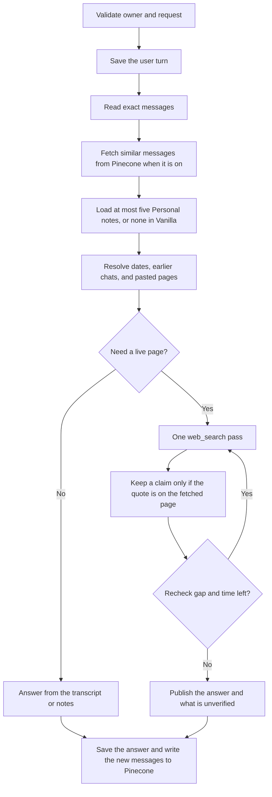

# minimi: exact history, current evidence

The question is not “what does a CRM cost?” It is “which five did we shortlist last Tuesday, and has a matching price changed since?” The agent keeps apart what was said, what was remembered, and what a current page supports.

**How it runs.** `npm install` then `npm run dev` starts one TypeScript Next.js app and one memory worker. The only model-facing tool is OpenAI hosted `web_search`. History, memory, and citation review are application code, so a page cannot add a tool or an instruction.

The answer model defaults to `gpt-6.2-sol` at medium reasoning. Memory and the page reviewer use `gpt-5.4-mini`. Keys and model names are in `.env.example`. A cookie scopes every row. The user turn is saved before inference. Duplicate requests and overlapping answers are rejected. SQLite runs the queries. When Redis is set, that file is copied to `minimi:db` with no key expiry and loaded on the other server if the copy is newer. Redis does not answer history queries, and it can still drop the file unless eviction is `noeviction`.

**How a turn is answered.** A date, “22nd nov”, or “other chats?” reads every owned thread on that local day and keeps the surrounding exchange, so a shortlist stays in order. Exact recall does not search. A current or uncertain fact may. A recheck, an attached page, a changed saved page, or an excerpt that misses the question must. “Do not search” is obeyed. Brief is one short pass. In-depth splits the question into at most four parts and searches only the parts that need a live source. The trace names the query, the page, and, when Pinecone is on, the similar messages it fetched and the messages it saved. A question about a specific day still reads SQLite only. A recheck gets one pass and, if the reviewer finds a gap and time remains, one follow-up. A failed follow-up keeps the earlier answer. A stable question can reuse a covering excerpt for a week. A time-sensitive question searches again even when that page is unchanged, because the news may be elsewhere.

**How a claim is kept.** Citations are named links beside the claim. A second, tool-free review keeps a claim only when its quote is an exact span of the fetched page and the number or date sits inside that quote. Otherwise it is insufficient or unavailable. “Page support · 0/10” means none of the ten claims survived. The answer stays visible, and those sentences are not verified. A price is “changed” only when old and new amounts share plan, region, currency, billing period, and unit. No baseline stays unverified. A current price does not prove when it changed.

**Memory.** The worker stores a preference, constraint, project, or decision only with a quote from an owned user message. Personal mode loads at most five notes for this question. An edited note outranks an older one. Vanilla loads none, and opens another chat only when asked. Expired and forgotten notes stay out. Deleting the message deletes the note. The transcript remains until you delete it. Synthesis is off the answer path, so a correction in the chat is visible before the worker runs.

**Storage.** The file is `.data/minimi.sqlite` locally and `/tmp` on Vercel. `MINIMI_SINGLE_USER=true` on the second server reuses the owner already in the file. The localhost cookie is a different owner.

**Rejected.** Extra model tools. Redis or a vector index as the record of what was said. Pinecone only suggests similar messages; the original text stays in SQLite. A router or a swarm. Treating the model’s own memory of a price as evidence.

**Checked, and not checked.** A local walkthrough with no model call recovered a 3 November shortlist, refused a cross-period price change, resolved “this page”, and applied an edited preference only in Personal mode. One live rerun took 8.2 s and 13.5 s on two PostgreSQL checks and 25.6 s on the CRM recheck. Two vendor pages could not be read. p50, p95, and a human-labeled holdout are not measured. See `docs/EVALUATION.md`.

**Another week.** Freeze a holdout, label it by hand, and report support, false changes, latency, and cost, including the worker. Keep Pinecone only while paraphrase checks still find the right message. Add account recovery if more than one browser should share the chats.
