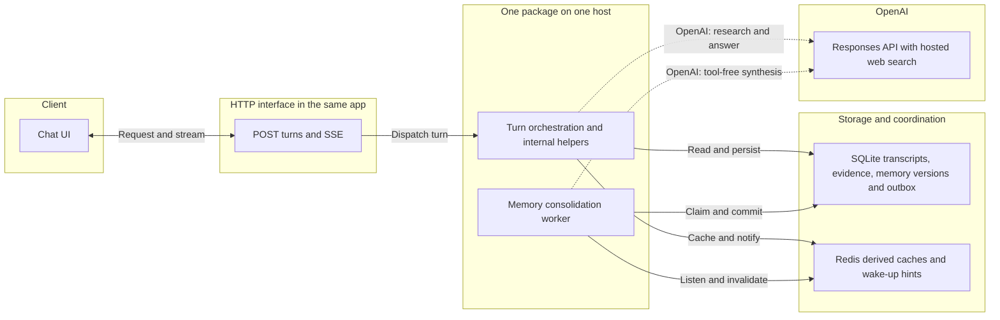
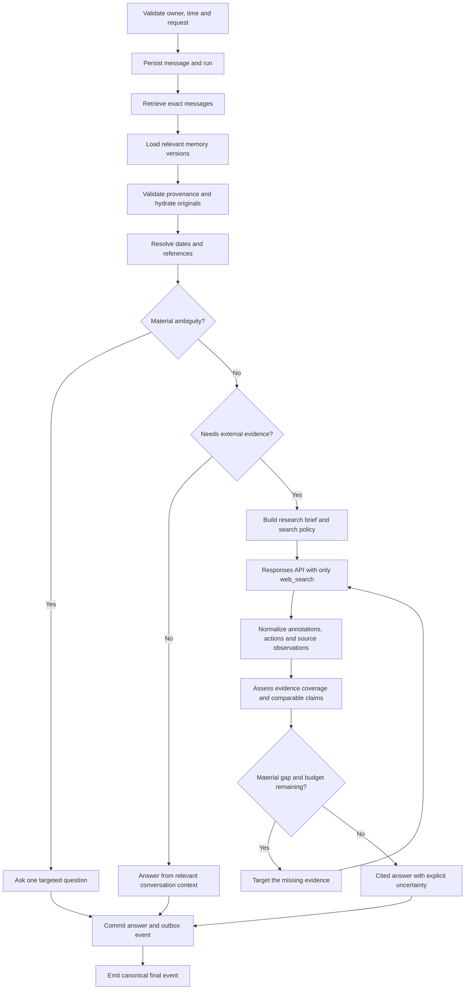
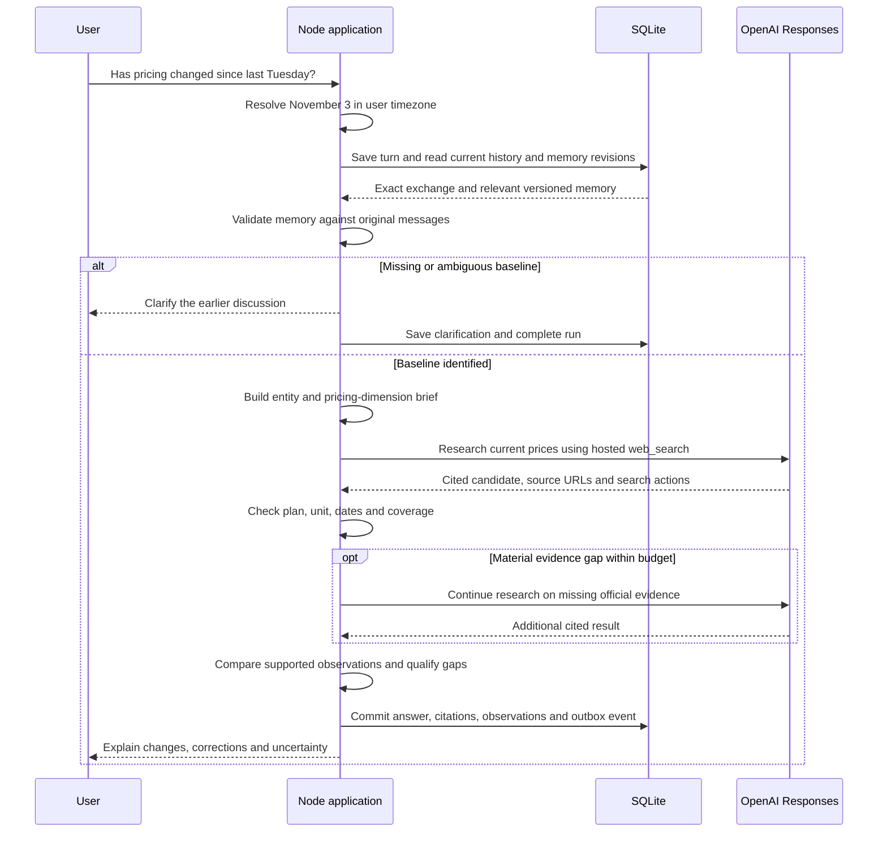
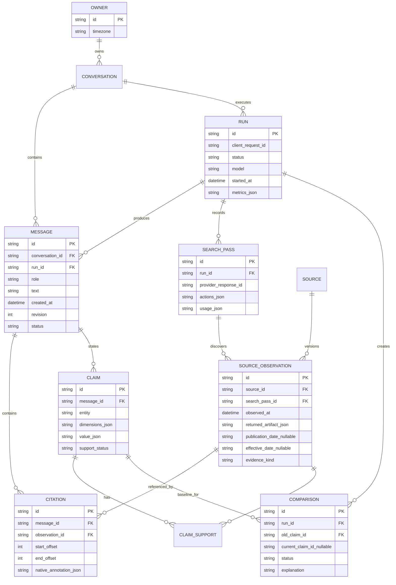
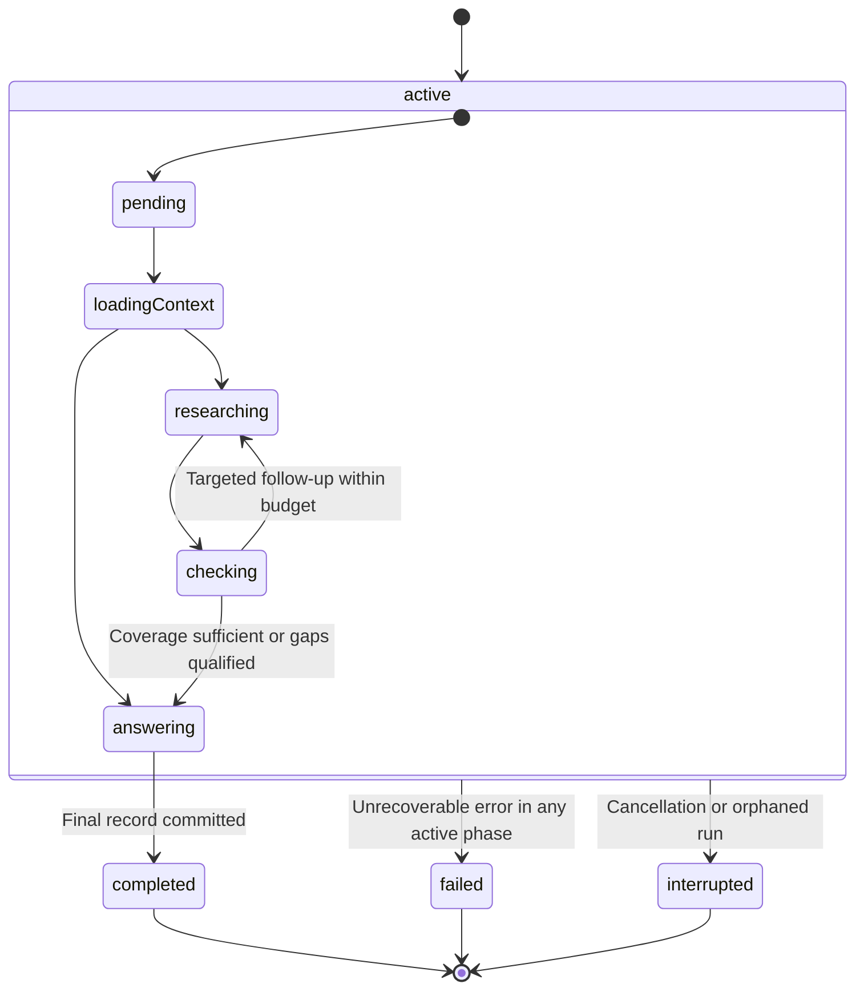
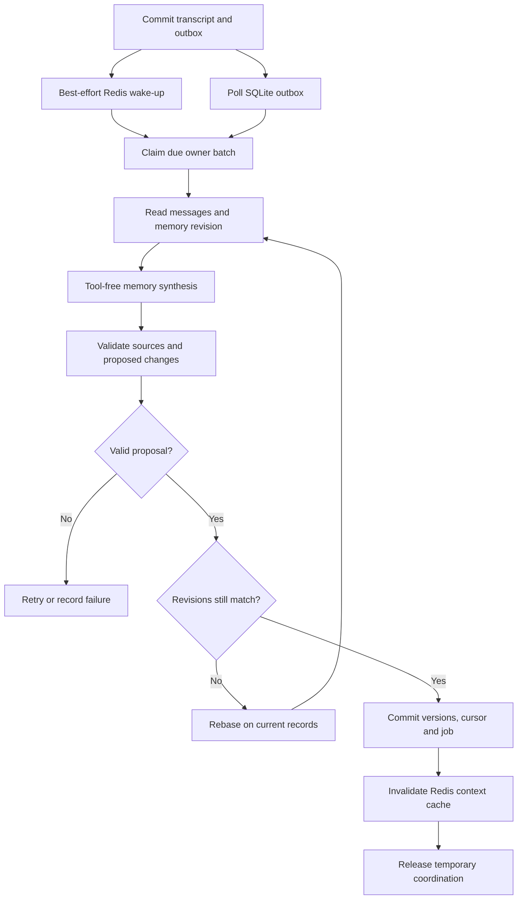
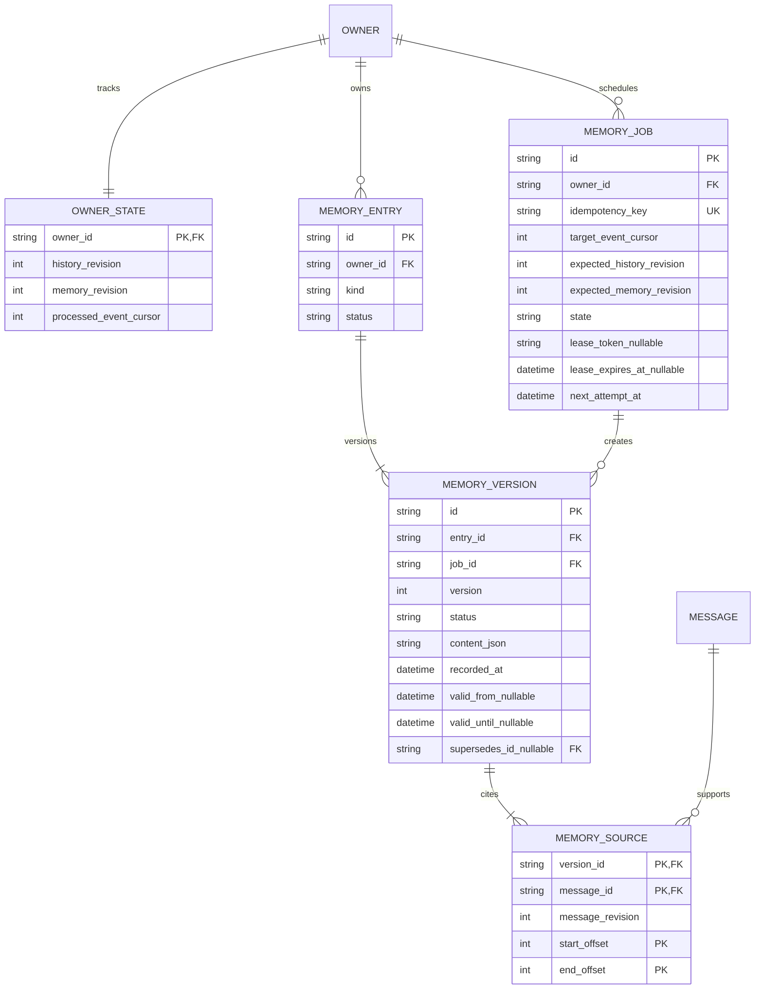
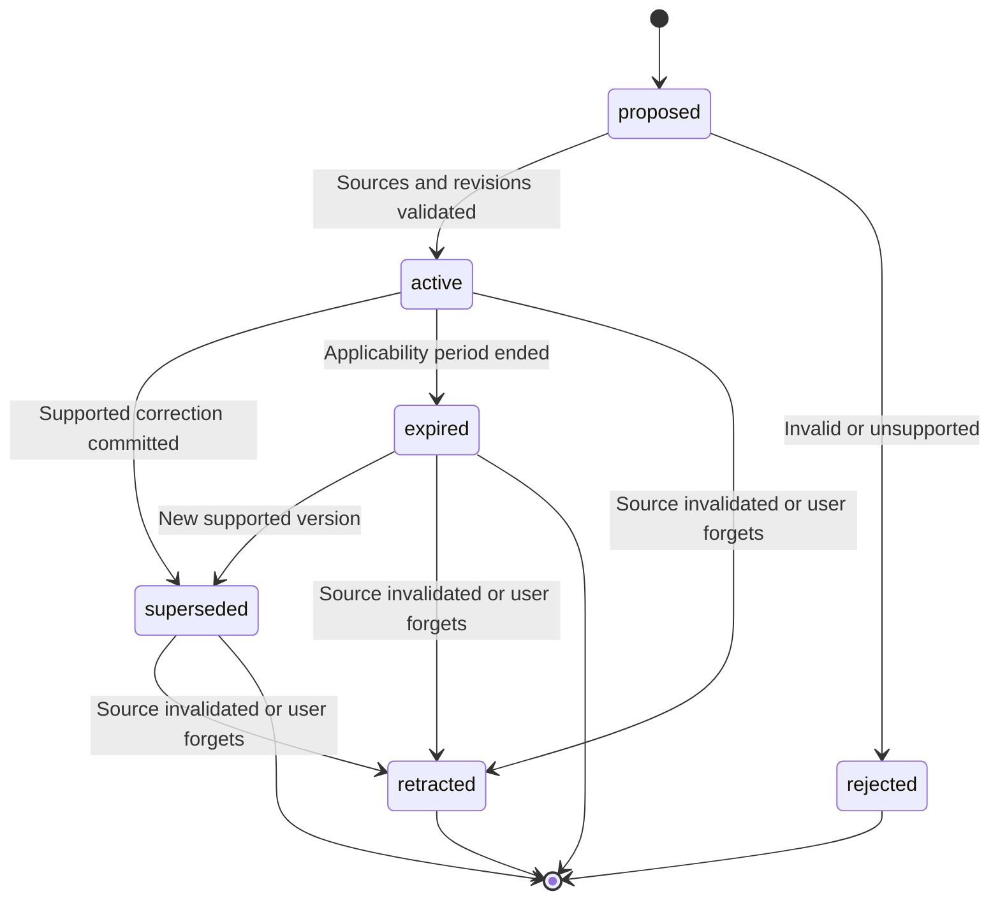
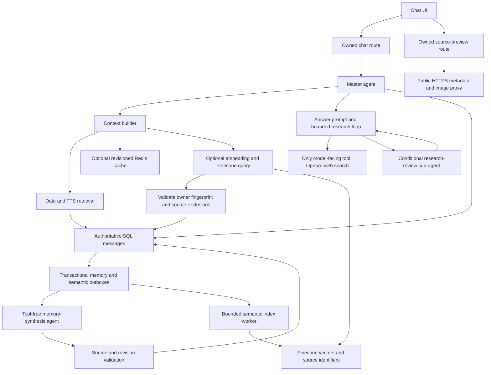
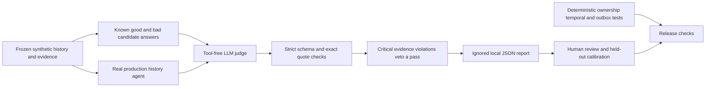

# Proposed architecture

Updated November 11, 2026. A working implementation now follows the deployment, research, retrieval, and consolidation flows below. The detailed ER diagrams and lifecycle charts are logical design targets; the implementation mapping and remaining gaps are recorded in section 11. OpenAI hosted web search is the only model-facing tool and the only external search provider.

See [the step-by-step plan](../plan.md) and [the source-based MultiBagg review](multibagg-review.md).

## 1. Deployment boundary

One repository/package contains a Node.js web application and a small Node.js consolidation worker, started together by `npm run dev`. SQLite is the durable authority for messages, memory versions, evidence, and pending jobs. Redis caches derived context and provides wake-up hints and short-lived coordination. The modules in later flowcharts are functions inside these processes, not separate microservices.

`OPENAI_API_KEY` and Redis credentials stay in server processes. No client can issue arbitrary database queries or read another owner's conversations. Hosted search's page-opening and in-page finding actions belong to that same tool. Consolidation calls expose no tools, including no web search. The composer microphone uses a separate OpenAI transcription call; that audio is not stored and is not a model tool. Saved public source URLs can be revalidated by validators or a visible-text hash so an unchanged page can skip a repeat search in the same conversation, while a changed page, a different requested URL, or a pronoun-dependent question still forces one.

The worker polls a durable SQLite outbox even if a Redis wake-up is lost. Redis is configured when the supplied credentials are available; connection failure falls back to SQLite reads and outbox polling. It must not lose history or prevent a turn from completing. This initial deployment assumes one host with shared access to the SQLite file, using WAL and short write transactions. Multiple hosts would require shared durable storage; Redis alone does not make local SQLite files consistent.

## 2. Internal turn pipeline

This is an application flowchart. Boxes represent functions or phases, not independently deployed services. History retrieval happens before research and never appears as another tool in the model's tool list. The application reads original messages before trusting derived memory, and a delayed worker never blocks the answer.

The loop stops on adequate coverage, exhausted deadline/pass budget, or no useful progress. API failures can yield a partial, explicitly unverified answer; cancellation yields an interrupted run. They do not become successful verification.

Memory caches are keyed by owner, history revision, memory revision, retrieval-policy version, and query. Read authoritative revisions before accepting a cache hit. Deleted or superseded source messages invalidate derived memory; newer raw corrections override an older consolidated version immediately. Exact-date recall and ordered-list references resolve against original messages, even when a summary is available.

## 3. Historical pricing recheck

Example: a synthetic prior conversation dated November 3 and a request frozen at November 10, 2026 in `Asia/Kolkata`. These fixture dates remain fixed even though this document was updated on November 11. The system must obtain the original providers from persisted messages. It must not guess them from the challenge prompt.

The model may carry out several hosted search actions inside either research request. Application pass counts and provider action counts must be recorded separately. Background consolidation consumes the outbox later; the answer does not wait for it.

## 4. Durable records

This logical schema captures the required relationships; implementation may use JSON columns for small nested structures. All reads are scoped through an owner. Source observations and message versions are immutable once finalized; deletion is an explicit user-data lifecycle operation.

`SOURCE` holds a stable normalized URL identity, not a mutable fact. Keep distinct observations when content or observation time differs. `CLAIM_SUPPORT` links claims to one or more observations; existence of a link is not itself semantic proof. `COMPARISON.current_claim_id` references a new claim when one exists; `unverified` comparisons may have no current claim. Implement that second foreign key even though its edge is omitted for readability.

Store message provenance for recall references separately from web citations. The consolidated memory schema is shown separately in section 8 to keep this evidence schema readable. Memory and any future semantic index point back to source messages and have explicit versions. The original messages remain the authority.

## 5. Run lifecycle

Terminal transitions use compare-and-set persistence so a late completion cannot overwrite cancellation. A timeout can produce an answered turn with stated uncertainty only if a valid final response is committed; otherwise the run fails. Startup reconciliation marks orphaned active runs interrupted. Retries after terminal failure are explicit new attempts linked to the original request.

## 6. SSE contract

Planned event types: `run.started`, `context.resolved`, `research.started`, `research.progress`, `answer.delta`, `answer.citations`, `run.completed`, `run.failed`, and `run.interrupted`. Every event has a run ID and sequence number. `run.completed` contains canonical message IDs, final text, citations, and metrics so client state can reconcile with persisted state.

Progress reflects observable actions. Candidate research prose stays private when another pass may replace it. Ordinary answers can stream; complex rechecks pass evidence checks before publication. Always distinguish first progress, first answer text, and first useful cited answer in metrics.

## 7. Background memory consolidation

OpenAI's [Dreaming post](https://openai.com/index/chatgpt-memory-dreaming/) describes background synthesis of conversational memory, with attention to relevant context, preferences, and changes over time. It does not publish a Dreaming V3 API or its complete implementation. The pipeline below is our own proposed design inspired by that approach.

**Scheduling:** Persist the outbox event in the same transaction as the completed exchange. Debounce per owner and consolidate bounded batches after several exchanges or an idle interval, with a maximum wait so steady traffic cannot postpone work forever. The worker starts with the development app and resumes unfinished jobs after restart. Timing and batch sizes are configuration to measure, not benchmark results.

**Recovery:** SQLite owns job status, retry time, lease expiry, and input coverage. Redis notifications are hints. Acquire leases transactionally; renew them for slow synthesis. Before commit, check the lease token, memory revision, history revision, and source eligibility. Reject stale-worker writes. Commit new memory versions, processed input cursor, and job completion atomically; a crash before commit leaves the job retryable. Redis invalidation after commit is best effort because revisioned cache keys already exclude stale entries. A failed job leaves the previous valid memory available while raw history remains immediately readable.

**Synthesis:** A tool-free model call proposes structured additions, revisions, or retractions from a bounded set of original messages and existing memory. The application validates schema, ownership, message IDs, message revisions, and exact supporting spans. It never accepts arbitrary model-generated SQL or edits. Semantic support still requires evaluation; a valid source pointer does not prove the synthesis is correct.

**Memory types:** Preferences, constraints, project context, decisions, discussion summaries, and explicitly reported events. Preserve ordered shortlists through links to the original exchange. Store assertions from users as reported assertions, and keep assistant/web claims with their separate evidence status. Consolidation does not turn a model answer into a verified fact.

**Time and corrections:** `recorded_at` describes when the system learned a claim; `valid_from`/`valid_until` describe its applicability when established. Mark a plan expired when its date passes, without inventing completion. A plan becomes completed only after supporting evidence or an explicit user report. Contradictions may supersede an earlier version or remain unresolved; the latest message is not automatically the most authoritative source for an external fact.

**Control:** Users can inspect memory entries and their source messages, correct them, and request deletion. Deletion increments the owner's history revision and immediately excludes dependent memory versions and caches, including while a worker is running. Reprocessing must not restore explicitly deleted entries. These are application records, not writes to the coding assistant's own memory folder.

## 8. Memory provenance and versioning

This is a second logical schema, linked to `OWNER` and `MESSAGE` from section 4. Every active derived version has at least one valid source. An `OWNER_STATE` row coordinates input coverage and revisions; separate jobs carry immutable input bounds and idempotency keys.

Unique `(entry_id, version)` prevents version collisions; source span offsets are part of the source-link key so multiple spans from one message can be stored. `supersedes_id` links versions of the same entry. Empty-source proposals are rejected. Store model, prompt/schema version, input revision, and job usage in the job's audit metadata. Retain a deletion tombstone or equivalent exclusion record so a retry cannot recreate a forgotten entry.

The worker's checkpoint is an append-only **event** cursor, not the timestamp or ID of the latest message. Edits, corrections, and deletions emit events too. A job advances only through the events it processed; later arrivals stay pending. Time-based applicability is also checked on reads so an idle worker cannot keep an expired plan active.

## 9. Memory lifecycle

States describe a derived version's eligibility for current context. Expired or superseded material may still explain historical discussion when its source remains available; retracted material must not be returned as active memory. Transcript deletion removes or redacts associated content according to the user-data lifecycle. None of these transitions proves a real-world event happened or a price changed.

## 10. Responsibility chart

| Information or action                        | Authority                                   | Redis role                               | Answer-path rule                         |
| -------------------------------------------- | ------------------------------------------- | ---------------------------------------- | ---------------------------------------- |
| Exact dated conversation and option order    | Original SQLite messages                    | Optional revisioned context cache        | Hydrate original exchange                |
| Derived preferences, decisions, summaries    | Source-linked SQLite memory versions        | Cache relevant current versions          | Apply corrections and validity checks    |
| Current pricing and release evidence         | New OpenAI web-search observations          | No reuse as proof of a fresh check       | Search and compare compatible claims     |
| Pending consolidation and processed coverage | SQLite outbox, leases, and event cursor     | Wake-up hints and temporary coordination | Never wait for consolidation             |
| Memory deletion or correction                | Scoped application transaction and revision | Invalidate affected cache generations    | Take effect before the worker catches up |

This chart describes system responsibilities; section 11 maps them to implemented services and remaining limits. It does not claim measured performance. See [plan.md](../plan.md#10-step-by-step-implementation) for the revised build order and evaluation gates.

## 11. Implementation mapping and limits

The deployment and flow diagrams now have a working implementation. The ERDs retain the richer logical design so future work is visible; they are not literal DDL. Current tables are defined in [the store](../src/db/store.ts).

| Diagram concept                | Current code and boundary                                                                                                                                                                                                                                           |
| ------------------------------ | ------------------------------------------------------------------------------------------------------------------------------------------------------------------------------------------------------------------------------------------------------------------- |
| Web process and worker         | [dev supervisor](../scripts/dev.mjs), [chat route](../app/api/chat/route.ts), and [worker](../src/memory/worker.ts); shared local SQLite is required                                                                                                                |
| Original history and retrieval | `owners`, `conversations`, `messages`, `runs`, `events`, and `message_fts`; [context builder](../src/ai/context.ts) hydrates original messages and preserves timestamps                                                                                             |
| Research observations          | `search_passes.artifact` holds returned output/actions/usage; message rows hold native citations and consulted-source metadata. `SOURCE`, `CLAIM_SUPPORT`, and `COMPARISON` are logical targets, not separate current tables                                        |
| Versioned memory               | `memories` stores snapshot rows with source message IDs and exact quotes, creation time, version, applicability end, and job token. Current versions are selected by eligibility; separate entry/version/source tables and applicability-start dates remain targets |
| Outbox and fencing             | `memory_jobs`, owner revisions, and the event cursor implement durable polling and lease-token/revision checks. A batch target is captured when claimed and validated at commit; job history is not yet a full audit ledger                                         |
| Forget and corrections         | `forgotten` and `memory_exclusions` prevent source-based resurrection of derived memory. New raw corrections accompany old memory in answer context. Transcript edit/delete endpoints and direct memory-text editing are not exposed                                |
| Memory and run states          | Charts describe intended semantic lifecycles. The current SQL uses run status and memory active/expiry fields; it does not persist every named memory lifecycle state                                                                                               |

The worker retries failures with bounded exponential backoff and pauses after five attempts until new input or a manual refresh reschedules it. It reads bounded event batches and validates exact user-message support. Structural checks do not establish semantic correctness of every proposed memory or cited claim. See [verification evidence](EVALUATION.md) for what was actually exercised.

## 12. Current modular execution and optional semantic recall

This diagram describes the implemented modules. Pinecone is opt-in and has not been verified live; the user will provide keys later. SQL is currently SQLite. A serverless/multi-host deployment requires migrating authoritative persistence to Postgres first.

The answer agent receives canonical records, not arbitrary Pinecone text. A vector hit is a retrieval candidate; it never proves a price or historical event. Index IDs are deterministic, jobs are leased and retried, and configuration-specific namespaces allow reindexing when models/dimensions change. Failed semantic queries leave date/FTS recall available. Forget exclusions are checked again when hydrating candidates. Full source deletion and provider-side vector cleanup remain future lifecycle work.

| Layer      | Code                                                | Responsibility                                                                  |
| ---------- | --------------------------------------------------- | ------------------------------------------------------------------------------- |
| Agents     | `src/ai/__agents__/`                                | Master turn, conditional research reviewer, background synthesis, offline judge |
| Prompts    | `src/ai/__prompts__/`                               | Versionable instructions, separate from orchestration                           |
| Tools      | `src/ai/__tools__/`                                 | Sole model-facing web registry and internal provider adapters                   |
| Context    | `src/ai/context.ts`                                 | Date/FTS/semantic rankings, exchange hydration, context budget                  |
| Storage    | `src/db/store.ts`, `src/memory/index-jobs.ts`       | Canonical history and transactional job lifecycle                               |
| Evaluation | `src/ai/__evals__/`, `src/ai/__data__/`             | Rubric, fixtures, calibration, production-agent evaluation                      |
| Preview UI | `SourcePreviews.tsx`, `src/server/link-previews.ts` | Open Graph images/titles as UI enrichment, outside research evidence            |

## 13. Offline judge and verification gates

Judge calibration and production-agent quality are different experiments. Neither judge scores nor citations alone prove truth. The judge sees the actual persisted message IDs for history-link validation and supplied evidence excerpts for factual assessment. It cannot inspect hidden hosted-search pages or independently verify absent evidence. Invalid verdicts are unscored failures. Live research evaluation, human agreement and controlled memory ablations remain next steps.

Implementation references checked for this update: [Pinecone vector operations](https://sdk.pinecone.io/typescript/documents/data-operations_working-with-vectors.html), [namespaces](https://sdk.pinecone.io/typescript/documents/data-operations_namespaces.html), [OpenAI embeddings](https://developers.openai.com/api/docs/guides/embeddings), and [evaluation best practices](https://developers.openai.com/api/docs/guides/evaluation-best-practices). The evaluator uses ordinary Responses calls and local artifacts; it does not depend on the deprecated hosted Evals platform.
