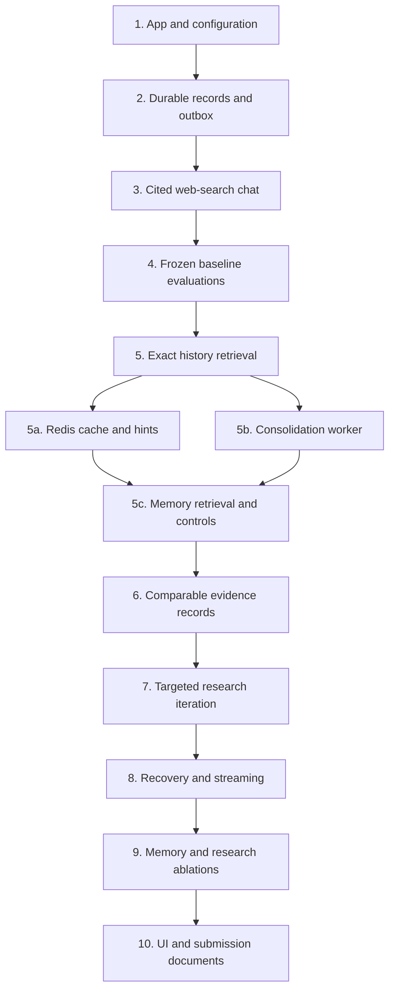

# Build plan: minimi chat agent

> Updated 11 November 2026. Start with [section 16](#16-current-plan-and-next-agent-handoff--11-november-2026) for the current implementation and next steps. [Cloud-agent handoff](docs/HANDOFF.md) has commands, verification results, and unfinished work. Earlier sections retain the original design rationale.

Updated November 11, 2026. The original plan below now has a working implementation; section 15 records what shipped, what was verified, and what remains a target. Background consolidation is inspired by OpenAI's Dreaming post, with Redis for derived caches and worker coordination. **OpenAI's built-in web search remains the only model-facing tool.**

## 1. The system we will build

Build a general conversational research agent that remembers actual conversations, searches when facts need checking, and explains what changed since an earlier answer. Use one Node.js package with a web process and a small background consolidation worker, a local durable database, Redis when configured, and OpenAI's Responses API. The only model-facing tool is `{ type: "web_search" }`. Memory synthesis uses tool-free model calls outside the answer path.

The architectural advantage should come from **recovering the right history, comparing like-for-like facts, and knowing when evidence is insufficient**. We will establish a working baseline early, then improve it using measured failures. We cannot claim superiority to other chatbots before evaluation.

Related documents:

- [Challenge requirements](CHALLENGE_BRIEF.md)
- [Architecture diagrams and data model](docs/architecture.md)
- [MultiBagg code review and lessons](docs/multibagg-review.md)

## 2. Non-negotiable requirements

| Requirement                                    | How we satisfy it                                                                                                                                |
| ---------------------------------------------- | ------------------------------------------------------------------------------------------------------------------------------------------------ |
| JavaScript or TypeScript on Node               | TypeScript throughout; Node runtime for server routes                                                                                            |
| `npm install`, then `npm run dev`              | One package; automatic local migrations; web process and worker start together; supplied Redis credentials enable caching, with a local fallback |
| One tool: web search                           | One hosted OpenAI `web_search` declaration; local helpers are application code, not extra function tools                                         |
| Every required API key listed                  | List `OPENAI_API_KEY` and the configured Redis connection variables in `.env.example`; never expose values                                       |
| Any model/framework allowed                    | Begin with a supported reasoning model; benchmark quality and latency before fixing the submission default                                       |
| Public GitHub repository                       | Implement original code; publish no MultiBagg source, credentials, private messages, or runtime database                                         |
| One-page `DESIGN.md`                           | Write it from the final implementation and measured trade-offs; this longer plan is not its replacement                                          |
| Architecture, correctness, speed, conversation | Evaluate these directly; keep the interface focused on chat, history, and usable citations                                                       |

The internship's Mac assistant and proactive nudges remain product context. They are not additional challenge deliverables.

## 3. Stack and boundaries

| Component                  | Initial choice                                                                               | Reason and limit                                                                                                            |
| -------------------------- | -------------------------------------------------------------------------------------------- | --------------------------------------------------------------------------------------------------------------------------- |
| Web app and HTTP endpoints | Next.js + React, running on Node                                                             | Familiar full-stack setup, one dev command; no Edge runtime for SQLite                                                      |
| Model/search integration   | Official OpenAI Node SDK, Responses API, hosted `web_search`                                 | One provider and one API key; native search annotations and action metadata                                                 |
| Model                      | Configurable `OPENAI_MODEL`; first candidate `gpt-6-astra` from current search documentation | Provisional candidate, not a measured winner; confirm account access and compare supported options before release           |
| Persistence                | SQLite + FTS5 via a maintained Node driver                                                   | Durable messages and local lexical retrieval without another service; verify fresh installation on documented Node versions |
| Memory consolidation       | Small Node worker consuming a SQLite outbox                                                  | Source-linked, versioned memory; durable event cursor and recoverable jobs; original messages remain authoritative          |
| Cache and coordination     | Redis using the supplied credentials                                                         | Derived context cache, wake-up hints, temporary coordination; SQLite owns history and jobs                                  |
| Schemas                    | Zod and explicit TypeScript interfaces                                                       | Validate HTTP inputs, internal plans, and normalized API output                                                             |
| Time                       | Injected clock plus an IANA-timezone-aware date library                                      | Reproducible tests and correct local date boundaries, including daylight saving changes                                     |
| Transport                  | POST + SSE, consumed through `fetch`                                                         | Structured events, cancellation, and request bodies rather than prompts in URLs                                             |
| Verification               | Vitest for core behavior; browser checks for streaming and citations                         | Frozen fixtures for repeatability; separate live API smoke tests                                                            |

No LangGraph, agent swarm, external vector service, or separate queue framework is needed initially. The durable outbox is the job queue; Redis notifications accelerate it without becoming its authority. The worker and web process share SQLite on one host. Add semantic retrieval only if paraphrase tests show a recall gap that query expansion and consolidated context cannot close. Keep a retrieval interface so this change does not affect the agent loop.

## 4. Secondary helpers, while keeping exactly one tool

These are server-side functions controlled by the application. They are not registered in the model's `tools` array. Some may use a tool-free model call when language understanding is necessary; such calls are counted and benchmarked.

| Helper                        | Responsibility                                                                                                      |
| ----------------------------- | ------------------------------------------------------------------------------------------------------------------- |
| `resolveTimeContext`          | Convert an explicit date or relative phrase into a validated interval using the request time and user's timezone    |
| `retrieveConversationContext` | Search owned messages across threads; return exact messages, original ordering, timestamps, and linked evidence     |
| `buildResearchBrief`          | Turn the question and resolved history into entities, comparison dimensions, hypotheses, and missing evidence       |
| `buildSearchPolicy`           | Choose whether search is required, broad or official-domain research, context size, and remaining budgets           |
| `normalizeSearchResponse`     | Preserve returned search actions, native citations, source metadata, response status, and usage                     |
| `registerEvidence`            | Assign stable source identities and immutable observations; deduplicate without renumbering earlier references      |
| `assessCoverage`              | Identify missing entities, incomparable prices, unsupported change dates, conflicting sources, and absent citations |
| `compareClaims`               | Separate changed facts, corrected earlier mistakes, still-supported claims, and unresolved checks                   |
| `renderCitations`             | Render native annotations as clickable citations; preserve text offsets and the cited answer version                |
| `consolidateMemory`           | Propose source-linked memory updates from bounded original messages using a tool-free model call                    |
| `validateMemoryProposal`      | Check schema, owner, original supporting spans, source revisions, and correction/delete exclusions                  |
| `readApplicableMemory`        | Load relevant versions, check applicability and source eligibility, and overlay newer raw corrections               |

Query planning gives the model search objectives, exact entities, dates, and source preferences. **Hosted search chooses its own actual queries**; we do not pretend we can execute or intercept every query or rerank its unseen raw results. Record actual query/action metadata when the API returns it.

## 5. Request flow and iterative research

1. Validate the request and server-issued user/session scope. Capture `now`, timezone, request ID, and conversation version. Persist the user message and a pending run before calling the model.
2. Load recent turns and retrieve older candidate messages when the request refers to history. Load relevant consolidated memories as retrieval aids, hydrate their original sources, and overlay any newer raw corrections. Validate cache keys against authoritative history and memory revisions. Filter by ownership and date before constructing context. Keep conversation history separate from external evidence.
3. Resolve the intended conversation and comparison baseline. A small structured planning call is allowed for difficult references; ordinary questions should not pay for a mandatory planner. If multiple candidates remain materially plausible, ask one precise clarification.
4. Choose the path: direct conversation, history-only recall, current research, or historical recheck. Greetings and exact recall do not need web access. Price, release, and “still correct today” checks require a fresh search attempt.
5. Make a Responses API call with only `web_search` available on research paths. Use required search when freshness is essential, live access enabled, and an explicit research brief. Use the normal hosted multi-step reasoning search first.
6. Collect the completed response, native annotations, consulted URLs, action metadata, and usage. Run deterministic checks, then an evidence-aware coverage assessment for complex comparisons. A consulted URL is not proof that it supports a particular claim.
7. If a material gap remains, continue with a targeted follow-up Responses request: for example, confirm annual versus monthly billing on the official pricing page, or look for a dated changelog. Reuse relevant response context using supported API continuation or item replay. Preserve required output/reasoning items; never reduce continuation to answer text alone.
8. Stop once coverage is adequate, the next pass adds no useful evidence, or the budget expires. A bounded search that finds no change yields “I could not verify a change,” not an unconditional claim that nothing changed.
9. Finalize the assistant message and run with a durable consolidation outbox event in one transaction, then emit the final cited answer and terminal event. Store failed or interrupted runs separately from successful answers. The worker consumes the event later; Redis wake-up failure must not block the answer.

**Two levels of iteration:** OpenAI may search, open pages, and find text within one hosted response. Our outer loop evaluates the returned result and makes another response only when a specific unresolved issue justifies it. These are sequential passes of one agent, not specialist agents.

Initial tunable budgets: one hosted research pass by default; at most two targeted follow-up passes; total turn deadline of 60 seconds; per-request deadline bounded by the remaining turn time. Allow at most one transient retry within that deadline. Enforce supported hosted tool-call limits where available and record observed action counts; do not confuse three Responses requests with three searches. Calibrate these limits against difficult questions before submission.

## 6. Conversation recall and temporal correctness

- Store original user/assistant messages with UTC timestamps and the user's timezone. Fetch messages across that user's threads when the question calls for it, rather than only the current thread's last five turns.
- Use recent turns, explicit date ranges, entity aliases, and FTS5 candidates. Expand candidates to the surrounding exchange and any selected list. Bound the context by tokens, preserving message IDs and exact quoted spans.
- An explicit date-only recall request must retrieve all user messages in that local date interval, with pagination if needed. It must not depend on keywords that may be absent from the question.
- Preserve the order and identity of compared options. “The second one” resolves against the relevant displayed list, not a new search result ranking. User corrections supersede earlier preferences without deleting the original record.
- For large candidate sets, select using a structured model result restricted to candidate IDs. Low confidence means broaden retrieval or clarify, not fabricate a match. Empty retrieval is not proof that a conversation never existed.
- Define date semantics in tests: weeks start Monday; “last Tuesday” means the most recent Tuesday strictly before the request's local calendar date. If context points to a different interpretation, state the resolved date or clarify. Re-resolve historical relative phrases against their original message time.
- For example, with a frozen request time of November 10, 2026 in `Asia/Kolkata`, “last Tuesday” resolves to November 3, 2026. Use local midnight boundaries converted to UTC; do not subtract fixed 24-hour chunks for arbitrary timezones.
- Consolidated memories are derived records with source message IDs, supporting spans, and explicit versions. They never replace original messages as evidence. Do not import `USER_CONTEXT.md` or the supplied challenge examples as actual chat history.
- A clean installation has no historical messages. Provide an explicitly labelled synthetic fixture for testing the examples and an empty-history response for ordinary users. Fixture data must never masquerade as a real conversation.

### Background consolidation inspired by Dreaming

OpenAI's [Dreaming post](https://openai.com/index/chatgpt-memory-dreaming/) motivates synthesizing useful conversational memory in the background and keeping it relevant as context changes. We will implement our own consolidation pipeline, not claim access to Dreaming V3 or reproduce unpublished internals.

1. Keep exact transcripts and evidence in SQLite. An append-only event stream includes message creation, correction, and deletion; it is the worker's coverage boundary.
2. Persist a consolidation outbox entry with each completed exchange. Debounce work per owner, bound each batch, and impose a maximum wait. Redis provides fast wake-up hints while durable polling handles lost notifications.
3. Run tool-free synthesis over original messages and the previous memory revision. Propose typed preferences, constraints, project context, decisions, discussion summaries, and reported events, each supported by valid message spans.
4. Validate the proposal. Commit only if the lease, input history revision, and expected memory revision still match. Atomically publish versions, advance the processed event cursor, and complete the job. Retry or rebase conflicting work; never overwrite newer corrections.
5. Cache derived context in Redis using owner/history/memory/policy revisions. A Redis outage falls back to SQLite and does not lose history or jobs. Context retrieval must not wait for consolidation.
6. Preserve `recorded_at` separately from established applicability dates. Supersede corrected memories, exclude deleted sources, and expire time-limited plans without inferring they happened. User reports and model assertions retain their provenance and evidence status.
7. Provide an inspectable memory view with source links and correction/forget controls. Apply deletion exclusions immediately and prevent queued work from recreating a forgotten entry.

Configure `REDIS_HOST`, `REDIS_PORT`, `REDIS_USERNAME`, `REDIS_PASSWORD`, and a documented TLS option when applicable; support a connection URL only if implemented. `.env.example` must distinguish optional cache configuration from the required OpenAI key. Do not read or print credentials when documenting this change.

Detailed [consolidation flow, memory schema, lifecycle, and responsibility chart](docs/architecture.md#7-background-memory-consolidation) define the read/write boundary. Background memory tokens, job latency, retries, and context freshness are measured separately from user-turn latency and search cost.

## 7. Evidence and change detection

Keep three separate records: **what was said**, **what evidence was available**, and **what a current check supports**. A saved assistant answer is evidence of its own wording, not independent proof of the underlying fact.

For pricing, identify the product, plan, region, currency, unit, monthly/annual billing, per-seat versus flat fee, taxes, usage limits, and promotional conditions. Unknown dimensions remain unknown. Compare only compatible observations; explain mismatches instead of reporting a misleading delta.

Use a typed comparison result:

```ts
type ComparisonStatus =
  | "changed" // comparable, supported old and new observations
  | "still_supported" // current evidence supports the same claim
  | "earlier_answer_wrong" // evidence places the correction before the baseline
  | "not_comparable" // plan, region, billing unit, etc. differ
  | "unverified"; // evidence cannot establish the answer
```

Record provider publication/update metadata separately from a fact's effective date and our retrieval time. A URL reused today may contain different content; append an observation rather than overwriting yesterday's evidence. A content hash describes only the text we actually stored.

OpenAI's hosted search exposes answer text, citation annotations, action metadata, and consulted source URLs. It does **not guarantee a complete raw page archive** in the API response. Store returned artifacts and any extracted claims as such. Label model-extracted excerpts as model-extracted; do not describe them as independently fetched, verified page snapshots. Missing page bodies and source dates are nullable. See the [official web search guide](https://developers.openai.com/api/docs/guides/tools-web-search).

For a disputed or material claim, ask hosted search to inspect the authoritative page and seek corroboration or a dated announcement. If the returned material still cannot establish support, preserve uncertainty. Structural citation checks catch missing annotations and bad references; they do not prove semantic truth.

Present temporal answers in a natural form: the resolved earlier discussion, the result of today's check, the meaningful changes, and remaining uncertainty. Cite earlier messages through local history links and current facts through web citations.

## 8. OpenAI integration contract

Illustrative request shape, to validate against the installed SDK and chosen model during implementation:

```ts
const request = {
  model: config.model,
  tools: [
    {
      type: "web_search",
      external_web_access: true,
      search_context_size: "medium",
    },
  ],
  tool_choice: mustCheckCurrentFacts ? "required" : "auto",
  include: ["web_search_call.action.sources"],
  input: buildResearchInput(context),
  stream: true,
};
```

For an official-source follow-up, apply `filters.allowed_domains` to this same search tool. Start broad if the relevant vendors/domains are unknown. Keep the full research context when switching passes. The tool supports page-opening and in-page finding actions on supported reasoning models; those are part of hosted search, not extra application tools. Source lists and native citation annotations have distinct purposes. See [OpenAI web search documentation](https://developers.openai.com/api/docs/guides/tools-web-search).

Use local persistence as the authority for history. Do not depend on provider response IDs being retained indefinitely. Verify the chosen storage/continuation mode and SDK event schema before implementing replay. Add an integration fixture that covers search actions, multiple message content blocks, annotation offsets, incomplete responses, and missing metadata.

## 9. Latency, streaming, and reliability

- Emit factual progress events from application/provider state: history loaded, searching, checking a gap. Do not generate decorative thinking narration or expose private chain of thought.
- For ordinary answers, stream text and reconcile citations from native annotations. Keep offsets tied to the original text; do not rewrite text before applying them. The final event carries the canonical saved text and citations.
- For temporal rechecks and high-impact comparisons, hold the candidate answer until coverage and citation checks finish. Show progress while checking; publish the accepted answer with citations rather than briefly presenting an unsupported draft. Measure the latency cost of this choice.
- Track time to first event, first answer text, first useful cited answer, and completion separately. A quick status message is not a fast answer.
- Freshness-sensitive turns bypass any application answer cache. Reuse historical evidence only as historical evidence. Live access permits current research but does not guarantee every page was freshly fetched or indexed.
- Propagate `AbortSignal` to SDK calls; store partial text as interrupted, never completed. Retry transient failures with bounded backoff; do not restart a partial visible answer in place without explicit replacement semantics.
- Use `(ownerId, clientRequestId)` idempotency and a conversation-version check. Duplicate requests return the existing run; concurrent turns are serialized or rejected with a clear conflict. Keep database transactions short and outside network waits.
- On startup, mark orphaned active runs interrupted. On reload, show their saved status. Keep background execution limited to the consolidation worker; add further infrastructure only when measured failures justify it.
- Start the consolidation worker with the web process through `npm run dev`; supervise termination so neither process is orphaned. Use a bounded worker lease and recover expired leases on restart. Redis wake-ups are optional; durable outbox polling is always available.
- Use WAL and short SQLite transactions for the two local processes. A stale worker must fail its revision/lease checks before publishing. A correction or deletion increments the authoritative history revision before old cached context can be reused.
- Bind all history/run queries to a server-issued owner scope. A local demo can use an opaque signed browser session; deployment needs an appropriate persistent auth/session secret. Never trust a client-supplied owner ID. Document the identity mode and deletion behavior.
- Treat web content and retrieved message text as data, not instructions. Sanitize rendered Markdown/links, never put keys in prompts, minimize personal history sent to public research requests, and log redacted operational metadata.

## 10. Step-by-step implementation

Each step ends with a working behavior or a reviewable gate. Checkboxes stay unchecked until implemented and verified.

| Step | Work                                                                                                                                                                                 | Completion gate                                                                                                                                                                            |
| ---- | ------------------------------------------------------------------------------------------------------------------------------------------------------------------------------------ | ------------------------------------------------------------------------------------------------------------------------------------------------------------------------------------------ |
| 1    | Set up one TypeScript/Next.js package, lockfile, Node requirement, `.gitignore`, configuration validation, `.env.example`, and automatic SQLite migrations. Preserve existing files. | A fresh checkout starts with the two required npm commands; missing configuration produces a useful error; secrets and runtime data stay out of Git.                                       |
| 2    | Define message, run, source-observation, citation, comparison, memory-version, and outbox schemas. Add ownership, revisions, idempotent turn creation, and run lifecycle.            | Messages survive restart; duplicate submissions create one turn; one browser session cannot read another's history; outbox events commit atomically with completed exchanges.              |
| 3    | Build the simplest end-to-end OpenAI web-search chat with SSE, cancellation, native citations, source lists, and usage capture.                                                      | A live question gets a cited answer through exactly one hosted tool declaration. Stop, failed requests, and reload behave correctly. Record this baseline.                                 |
| 4    | Create synthetic dated conversations and frozen API-response fixtures. Build a deterministic eval runner with an injected clock.                                                     | The baseline produces a saved report; fixtures are labelled; local replay does not require keys or network access.                                                                         |
| 5    | Implement cross-thread history retrieval, date resolution, ordered-list references, and bounded context assembly. Establish raw-history recall before adding derived memory.         | Date-only, paraphrased, ambiguous, missing-history, and cross-thread cases work; exact recall does not search the web unnecessarily.                                                       |
| 5a   | Connect Redis for revisioned context caching and wake-up hints, with timeouts and local fallback. Use the existing credentials without exposing them.                                | A configured Redis round-trip works; a Redis outage preserves answers/history; owner and revision changes prevent stale or cross-user cache hits.                                          |
| 5b   | Build tool-free memory synthesis, source/revision validation, and the durable outbox worker. Start it alongside the app.                                                             | Worker restart, duplicate delivery, concurrent correction, stale lease, and conflicting revisions cannot lose inputs or overwrite newer state. No extra model-facing tool is registered.   |
| 5c   | Integrate relevant consolidated context plus original-source hydration. Add inspect/correct/forget memory controls.                                                                  | New corrections apply before consolidation; planned events never become completed by time alone; deleted source content cannot be returned or resurrected.                                 |
| 6    | Add research briefs, required freshness checks, source observation versioning, and comparable claim records.                                                                         | Earlier statements remain distinguishable from verified facts; a pricing test rejects incompatible billing units and detects supported changes.                                            |
| 7    | Add coverage assessment and targeted outer-loop follow-ups. Keep them conditional; enforce deadlines, no-progress detection, and total budgets.                                      | Missing official evidence triggers a focused second pass; adequate evidence stops immediately; unreachable evidence yields uncertainty rather than invention.                              |
| 8    | Harden streaming and recovery: canonical final events, citation offsets, terminal-state persistence, interrupted runs, partial failures, and prompt-injection cases.                 | Browser refresh, abort, retry, out-of-order chunks, Unicode citations, and server restart preserve truthful state.                                                                         |
| 9    | Run controlled ablations for model choice, reasoning effort, raw-history versus consolidated memory, cache behavior, context size, coverage checks, and iteration.                   | Keep changes that improve measured quality; include background compute and stale-memory failures; report cost/latency trade-offs. Add semantic retrieval only if recall remains deficient. |
| 10   | Finish the focused UI, install smoke test, README, example conversations, evaluation report, and one-page `DESIGN.md`. Review public repository contents.                            | All challenge constraints are checked from a fresh checkout; documentation matches actual behavior and includes unresolved limits.                                                         |

Do steps 1–4 first to get a measurable vertical slice. Steps 5–7 address the challenge's hardest behavior. Polish after those work. This plan does not authorize deployment or submission through the application form.

### Implementation dependency chart

This chart records order and prerequisites, not estimated durations or completed work. The worker can be built independently of Redis because SQLite owns pending jobs; they meet when integrating the memory read path.



## 11. Evaluation that can distinguish a better architecture

Start with approximately 40 multi-turn cases, distributed across general conversation, current research, historical recall, temporal comparison, and failure handling. Include varied topics beyond CRM and Postgres so the system cannot win by hardcoding the supplied examples. Keep a held-out set separate from prompt tuning.

| Case family                    | What must be demonstrated                                                                                                                  |
| ------------------------------ | ------------------------------------------------------------------------------------------------------------------------------------------ |
| Five-option CRM shortlist      | Recover the actual five tools and 20-person constraint; cover each requested pricing/release dimension or label its gap                    |
| November 3 recall              | Retrieve every relevant user message on that local date; distinguish what the user asked from what the assistant answered                  |
| Postgres recheck               | Resolve the date, recover the original providers, compare matching plans and units, cite current evidence                                  |
| Ordinary conversation          | Direct, concise responses; relevant follow-ups; no needless research                                                                       |
| Old answer was incorrect       | Correct the old claim without inventing a new change event                                                                                 |
| No history / ambiguous history | Honest missing-context response or targeted clarification; never supply an invented shortlist                                              |
| Dates and scope                | Year rollover, daylight saving changes, midnight, relative dates in old messages, cross-thread retrieval, and owner isolation              |
| Evidence traps                 | Official page older than news; undated pricing; conflicting sources; promotion versus list price; URL content changed                      |
| API and streaming failures     | Rate limit, timeout, incomplete response, missing citations, duplicate requests, cancellation, restart, malformed persisted fixtures       |
| Adversarial content            | Web instructions do not override the user; private history does not enter irrelevant public queries                                        |
| Memory consolidation           | Relevant preferences/decisions survive across threads; every derived entry resolves to valid original sources                              |
| Memory staleness               | An expired plan is not a completed event; new constraints override old versions even with delayed jobs                                     |
| Memory recovery and deletion   | Lost Redis notification, worker crash, duplicate job, stale lease, source deletion, and correction during synthesis preserve current state |

Measure history retrieval recall/precision, date accuracy, reference resolution, claim support, citation coverage/correctness, change-classification accuracy, unnecessary-search rate, search action count, token usage, cost, and latency distributions. Use deterministic assertions where possible and human review plus evidence-aware model judging where needed. Never use stylistic confidence as a factuality score.

Proposed release gates: no invented-history answers or ownership leaks in the test suite; all deterministic date/reference fixtures pass; all material claims in the held-out recheck set are supported or explicitly qualified. Set quantitative recall/support thresholds after the baseline report, not after seeing the final result. These gates are proposed, not achieved.

Run frozen tests in CI. Run live checks separately with model/date/config recorded; label them non-deterministic. Compare baseline versus full system and individual ablations on the same cases. Publish failed cases and latency/cost distributions alongside improvements. Local tests are not proof of minimi's private evaluation performance.

Compare four memory configurations on identical held-out conversations: recent turns only; raw-history retrieval; raw history plus a naive rolling summary; and raw history plus source-linked consolidation. Measure factual recall, preference/constraint adherence, stale-memory errors, unsupported synthesis, deletion effectiveness, tokens, background cost, and answer latency. Include query-before-worker-completion cases. Present actual measurements only after implementation; there are no performance scores or improvement percentages yet.

## 12. Current repository structure

The AI layer follows MultiBagg's directory and filename convention. Storage and HTTP/UI code stay outside the AI layer.

```text
app/                             Next.js UI and thin Node API routes
src/ai/__agents__/               Master turn, research-review, memory, offline judge agents
src/ai/__tools__/                Sole model-facing web-search registry; internal embeddings/Pinecone adapters
src/ai/__prompts__/              Answer, research-review, memory and judge instructions
src/ai/__evals__/                Rubric, validation, local/live evaluation runner
src/ai/__data__/                 Synthetic, frozen evaluation fixtures
src/ai/context.ts                Date/FTS/semantic retrieval and context assembly
src/ai/evidence.ts               Provider artifact normalization and citation rendering
src/ai/policy.ts                 Search permission, freshness and recheck policy
src/memory/                      Consolidation worker, schemas, semantic outbox/indexing
src/db/                          Authoritative SQLite store and schema
src/cache/                       Optional Redis context cache and wake-up hints
src/components/                  Chat UI, mascot, source-preview cards
src/server/                      Owner session, origin checks, logging, safe preview fetching
src/stream/                      SSE parsing
src/time/                        Timezone-aware interval resolution
scripts/                         Development supervisor and live smoke checks
tests/                          Regression and integration checks
docs/                           Architecture, evaluation record and next-agent handoff
.env.example                     Configuration placeholders; no credentials
README.md                        Install/run/verification instructions
DESIGN.md                        One-page architectural explanation
```

## 13. Trade-offs and another week

Reject importing MultiBagg's domain-agent routing: it solves a multi-tool finance product, while this challenge has one general external capability. Reuse the ideas of bounded execution, source tracking, and observability in original code.

Reject third-party search providers, direct crawlers, and additional model-facing memory/browser tools under the current constraint. Official-domain follow-ups and hosted page inspection stay within OpenAI web search. If hosted retrieval cannot access a necessary page, the correct result may remain unverified.

Reject a verifier on every greeting and a mandatory planner on every turn. Apply extra work where it can change correctness. Reject long-lived application caches for “has this changed today?” questions. Reject raw-page archival claims when the API only returned annotations and model-generated text.

With another week, prioritize failures shown by evaluation: semantic recall and reranking if needed, consolidation quality and scheduling, richer entity/plan normalization, difficult held-out temporal cases, better source-support review, retrieval observability, and measured latency improvements. Broader deployment infrastructure comes after the core behavior is reliable.

## 14. Sources and verification boundaries

- Requirements: the user-supplied [challenge brief](CHALLENGE_BRIEF.md).
- MultiBagg findings: local source inspection recorded in [the review](docs/multibagg-review.md); no production, database, or live endpoint testing was performed.
- OpenAI behavior: [hosted web search](https://developers.openai.com/api/docs/guides/tools-web-search) and [function calling / output replay guidance](https://developers.openai.com/api/docs/guides/function-calling), checked November 10, 2026. SDK/model capability checks remain implementation work.
- SQLite retrieval: [official FTS5 documentation](https://www.sqlite.org/fts5.html). FTS5 provides local full-text retrieval and BM25 ranking; it does not solve semantic recall by itself.
- Memory inspiration: OpenAI's [Dreaming: Better memory for a more helpful ChatGPT](https://openai.com/index/chatgpt-memory-dreaming/), published June 4, 2026 and read in this conversation. Our worker, outbox, cache keys, schemas, and validation rules are proposed engineering decisions; the post does not document them as Dreaming V3 internals.

Implementation checks and live API smoke tests have now been run; see [the verification record](docs/EVALUATION.md). The broader benchmarking goals below are not yet achieved.

## 15. Implementation checkpoint

The runnable app now includes owner-scoped SQLite persistence, FTS5/date retrieval, Redis-derived context caching, native web-search citations, bounded research continuations, a source-linked memory worker, and an inspectable memory UI. `npm run dev` starts the two local processes. `DESIGN.md` describes the actual architectural choices in one page.

| Plan area                        | Current implementation                                                                                                                                                                                               |
| -------------------------------- | -------------------------------------------------------------------------------------------------------------------------------------------------------------------------------------------------------------------- |
| Setup, persistence, and research | Implemented; `.env.example`, automatic schema setup, original messages, research artifacts, SSE, idempotency, owner checks, cancellation paths, and usage traces                                                     |
| Historical retrieval             | Implemented dates, FTS5, recent context, ordered exchange hydration, partial-date reporting, and source hydration; optional Pinecone semantic retrieval is implemented but disabled and not live-verified            |
| Redis                            | Authenticated and temporary write/read checked; revisioned cache and wake-up hints implemented; outage fallback implemented but no live outage campaign performed                                                    |
| Memory                           | Worker, durable event cursor, leases, revision fencing, immutable snapshot content, exact support spans, applicability expiry, inspect/forget controls, and bounded retries implemented                              |
| Comparison evidence              | Original answers and returned provider artifacts persist; comparison categories and plan/unit checks are model instructions, not a separately verified claim database                                                |
| Evaluation                       | Core regressions, an evidence-aware LLM judge, calibration fixtures, and production-agent history evaluations implemented; held-out research quality, ablations, adversarial and load/crash campaigns remain pending |
| UI                               | Desktop visual review and browser submission exercised; full mobile/responsive interaction sign-off remains pending                                                                                                  |
| Delivery                         | README, DESIGN.md, diagrams, dependency chart, and verification notes present; categorical local commits prepared; no deployment or application submission performed                                                 |

Implementation differences from the initial defaults: the answer model is now `gpt-6-astra`, with `gpt-5.4-mini` for synthesis/review; the default turn deadline is 90 seconds. Memory uses full versioned snapshots and source-exclusion tombstones. Original transcript editing/deletion and a detailed fact-comparison database remain design targets. The current cache has a five-minute TTL; freshness-sensitive answers themselves are never cached.

## 16. Current plan and next-agent handoff — 11 November 2026

### Decisions to preserve

- Node.js/TypeScript, `npm install` then `npm run dev`, one-page `DESIGN.md`, `.env.example`, and OpenAI hosted **web search as the only conversational tool**.
- Match MultiBagg's separation of agents, tools, prompts, data and evals; specialist sub-agents handle distinct tasks, with no unnecessary domain-routing hierarchy.
- Reuse the configured OpenAI key. The user will supply Pinecone credentials later: leave `PINECONE_ENABLED=false` until then.
- Original messages and source-linked memory versions stay authoritative in SQL. Redis caches derived context; Pinecone retrieves related messages by meaning and never establishes an external fact.
- SQLite currently supports a single deployment host with persistent shared storage. For serverless or multiple app hosts, migrate the authority to managed Postgres before deploying.
- Show source images as Open Graph link-preview cards when available. Keep preview fetching separate from answer generation and web-search evidence.

### Implemented now

1. **Agent modules:** master turn orchestrator; conditional research-review sub-agent; background memory-synthesis agent; offline judge agent. All instructions moved to prompt modules. The production web-search tool registry exposes exactly one tool.
2. **Hybrid memory:** date and FTS5 retrieval, recent exchanges, source-linked consolidated memory; optional OpenAI embeddings + Pinecone retrieval with reciprocal rank fusion and original-record hydration. Semantic indexing has a transactional outbox, retry limits, fenced leases, owner namespaces, configuration-specific index versions, and source-exclusion checks.
3. **Offline evaluation:** keyless deterministic tests; `eval:judge` grades known good/bad synthetic answers; `eval:agent` exercises the real production orchestrator on isolated historical fixtures, then judges the output. Strict output validation leaves malformed verdicts unscored. Critical evidence failures cannot be averaged away by writing quality.
4. **Recall fix found by evals:** retrieval now runs for ordinary questions too, so a region preference can be recalled without the words “remember” or “earlier”. The evaluator now receives the real message IDs to validate historical deep links.
5. **Source preview implementation:** owned-message endpoints fetch at most three persisted source URLs; parse Open Graph/Twitter/title metadata; proxy raster images. HTTPS restrictions, connection-time public DNS checks, redirect/size/time limits and text fallbacks are implemented. A live Wispr Flow metadata/image smoke check passed; endpoint access tests and visual/browser QA remain next steps.
6. **Composer dictation:** the microphone records a short clip and `POST /api/transcribe` sends it to OpenAI speech-to-text. The transcript is inserted for editing. Audio is not stored, the route is owner-scoped and size-limited, and the answer model is not given a transcription tool.

### Next work, in order

| Step | Work                                                                                                                                                         | Completion evidence                                                                                                                                                                   |
| ---- | ------------------------------------------------------------------------------------------------------------------------------------------------------------ | ------------------------------------------------------------------------------------------------------------------------------------------------------------------------------------- |
| 1    | Finish verification of this refactor and the source-preview feature. Preserve concurrent logging/lint changes.                                               | Typecheck, tests, lint, build; owned-message access checks; live metadata/image fetch and browser rendering; no broken internal links.                                                |
| 2    | Harden and calibrate evals. Add realistic multi-turn pricing/release fixtures, citation support cases, prompt-injection and missing-baseline cases.          | Human-reviewed labels, judge agreement, unscored-error rate; full-agent research checks distinct from judge calibration; versioned results.                                           |
| 3    | Enable Pinecone only after credentials arrive. Use a dense cosine index, 1536 dimensions for the default embedding model, and separate environment prefixes. | Worker indexes synthetic records, paraphrase recall works across threads, owner isolation/forget exclusions/outage fallback/restarts verified live.                                   |
| 4    | Measure whether semantic retrieval and consolidation help.                                                                                                   | Same held-out cases with raw retrieval, consolidation, and Pinecone ablations; recall/correctness/latency/cost, including background calls.                                           |
| 5    | Choose deployment target; migrate SQL to Postgres if serverless/multi-host is required.                                                                      | Async repository interface, migrations/data transfer, PostgreSQL search, transactional worker claims, shared durable data, production auth and session recovery.                      |
| 6    | Submission review and packaging.                                                                                                                             | `npm install && npm run dev` from a clean checkout, all keys documented, one-page DESIGN reflects actual code, public repo reviewed for secrets, user handles publication/submission. |

Do not call this implementation “best on the internet” based on smoke tests. The latest four real-agent history fixtures all passed the evidence-aware judge; this is a small synthetic sample. One initial judge calibration verdict was invalid and was not counted as a quality score; a targeted rerun succeeded. See [HANDOFF.md](docs/HANDOFF.md) and [EVALUATION.md](docs/EVALUATION.md).
